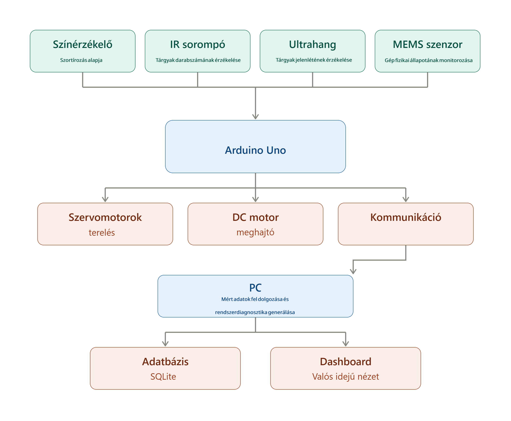

# Ipar 4.0 + MEMS kisprojekt Arduino Unóval

## Alapkoncepció
Okos szortírozó sor": egy futószalagon (vagy lejtős csúszdán) tárgyak (pl. színes műanyag korongok, kis dobozkák, LEGO elemek) haladnak végig, a rendszer felismeri a típusukat/színüket/méretüket, majd egy szervóval/tolóval elválasztja őket a megfelelő gyűjtőrekeszbe — közben minden eseményt naplóz és egy dashboardon megjeleníti (ez adja az Ipar 4.0 réteget).

## Mechanikai felépítés
* Kis szállítószalag (DC motorral hajtva, vagy egyszerűbb: lejtős sín gravitációs mozgatással)
* 2-3 elágazási pont szervomotorral vezérelt terelőlapokkal
* Gyűjtőrekeszek a kimeneteknél

## Elektronika / érzékelők (Arduino Uno köré)
| Funkció | Alkatrész |
| -------- | ------- |
| Színfelismerés | színérzékelő |
| Tárgy jelenlét / darabszám | IR fénysorompó |
| Távolság / méret | ultrahangos szenzor |
| MEMS: rezgés | szalag rezgésének monitorozására |
| MEMS: hang | MEMS mikrofon modul — pl. kopogás/ütközés-detektálás |
| Elágazás | mikroszervó |
| Kommunikáció | Mikrovezérlés |

## Szoftverarchitektúra
[Arduino Uno] --soros/BT/ESP--> [PC vagy Raspberry Pi]
                                        │
                                 Python/Node-RED
                                        │
                              adatbázis (SQLite/InfluxDB)
                                        │
                              webes dashboard (Node-RED UI / Grafana / egyszerű HTML+JS)

## Rendszerarchitektúra

